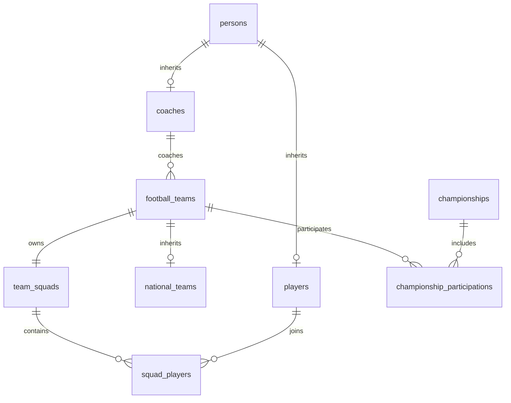

# Football Management System

Навчальне ядро футбольного менеджера охоплює спринти 2–10.
Python 3.12+, SQLAlchemy 2.x, asyncpg, PostgreSQL, Alembic, pytest.

## Запуск і перевірки

Команди виконуються з кореня проєкту в PowerShell:

```powershell
.venv\Scripts\python.exe -m pip install -e ".[test]"
# Для нового середовища: скопіюйте .env.example у .env і задайте свої параметри.
.venv\Scripts\python.exe -m alembic upgrade head
.venv\Scripts\python.exe -m alembic current
.venv\Scripts\python.exe -m alembic check
.venv\Scripts\python.exe -m pytest -q
.venv\Scripts\python.exe -m mypy app
```

Для запуску графічного застосунку після встановлення залежностей і міграцій виконайте:

```powershell
.venv\Scripts\python.exe -m app.main
```

Після `pip install -e ".[test]"` також доступна команда `football-manager`.
Для заповнення порожньої БД прикладами запустіть `.venv\Scripts\python.exe -m app.seed_demo`.
У GUI списки команд, гравців, тренерів і чемпіонатів призначені для перегляду та пошуку.
Для пошуку введіть назву або місто й натисніть Enter чи «Застосувати».
У формі чемпіонату можна вказати один рік або два послідовні роки, як-от
`2026/2027`. Склад збірної зберігається разом із її профілем після перевірки
гравців та номерів.

Тести без PostgreSQL, включно з GUI-тестами:

```powershell
.venv\Scripts\python.exe -m pytest -q -m "not integration"
```

Лише інтеграційні тести:

```powershell
.venv\Scripts\python.exe -m pytest -q -m integration
```

Інтеграційні тести використовують `TEST_DATABASE_URL`, а за його відсутності —
налаштування основного підключення. Кожен тест створює власну схему `fm_test_<uuid>`,
виконує в ній справжні міграції та видаляє тільки цю схему після завершення.
Користувач PostgreSQL повинен мати право створення схем у вибраній БД.
Якщо підключення не налаштоване, інтеграційні тести пропускаються; якщо воно
налаштоване, але недоступне, тести завершуються помилкою.

Пріоритет конфігурації: `DATABASE_URL`, сумісний зі старим проєктом
`DATABASE_ALEMBIC_URL`, потім `DB_HOST/PORT/NAME/USER/PASSWORD`.
Для кожного ключа змінна середовища має пріоритет перед `.env`.
Пароль з особливими символами безпечніше передавати через `DB_PASSWORD`:
`URL.create()` правильно його екранує. Не публікуйте `.env`.

## Архітектура

- `app/domain/`: звичайні Python-класи, валідація та зв'язки предметної області.
- `app/application/services/` містить сервіси для гравців, тренерів, команд, чемпіонатів і збірних.
- `app/application/national_team_builder.py` формує збірну й перевіряє склад.
- `app/presentation/` містить PySide6-сторінки, форми, таблиці та цикл qasync.
- `app/infrastructure/` містить Domain↔ORM мапери, репозиторії та Unit of Work.
- `app/common/shell_sorter.py`: незалежний Shell Sort з ключем.
- `app/db/base.py`: `DeclarativeBase` і правила іменування обмежень.
- `app/db/enums.py`: повторне використання доменного enum без залежності Domain від ORM.
- `app/db/models.py`: ORM-моделі та асоціативна сутність складу.
- `app/db/session.py`: конфігурація, async engine, фабрика й контекст сесії.
- `alembic/versions/`: історія схеми БД.
- `tests/`: доменні, сценарні та PostgreSQL інтеграційні тести.


## Схема БД



Наслідування `PersonModel → PlayerModel/CoachModel` і
`FootballTeamModel → NationalTeamModel` реалізоване через joined-table inheritance.
SQLAlchemy повертає конкретні підкласи навіть у запитах до батьківської моделі.
Базову `PersonModel` також можна зберегти з дискримінатором `person`.

ТЗ спочатку пропонує `Player.squad_id`, але далі прямо замінює його M:N-зв'язком.
Тут використано остаточне уточнення: `squad_players(squad_id, player_id, shirt_number)`.
Один гравець може представляти клуб і збірну з різними номерами.
`PlayerModel.shirt_number` — початковий номер гравця; номер заявки зберігається
в `SquadPlayerModel.shirt_number` і має унікальність у межах складу.

Усі PK, FK, NOT NULL, обмеження номерів 1–99, невід'ємного досвіду,
додатного місця, непорожніх назви/міста/країни збірної та унікальності
участі/місця/складу задані на рівні БД. Чемпіонат унікальний за
`(name, country, season)`. `players.position` — PostgreSQL enum.

`FootballTeamModel` автоматично створює свій склад у конструкторі.
`UNIQUE(team_squads.team_id)` гарантує щонайбільше один склад на команду;
обов'язкове створення складу забезпечує ORM-конструктор, як і композиція в Domain.
Правило одного поточного клубу перевіряється доменним складом; таблиця
асоціацій підтримує загальні множинні належності й сама не розрізняє клубні ліміти.

### Приклад роботи без Repository

```python
from datetime import date
from app.db.models import CoachModel, FootballTeamModel, PlayerModel
from app.db.enums import PlayerPositionEnum
from app.db.session import get_session, close_database

async def example() -> None:
    try:
        async with get_session() as session:
            coach = CoachModel(first_name="Олег", last_name="Тест",
                               date_of_birth=date(1980, 1, 1), experience_years=10)
            team = FootballTeamModel(name="Динамо", city="Київ", coach=coach)
            player = PlayerModel(first_name="Андрій", last_name="Тест",
                                 date_of_birth=date(2000, 1, 1),
                                 position=PlayerPositionEnum.FORWARD, shirt_number=9)
            team.squad.players.append(player)
            session.add(team)
    finally:
        await close_database()
```

`get_session()` комітить успішну транзакцію, відкочує її за винятку й закриває
сесію. `expire_on_commit=False` дозволяє читати вже завантажені атрибути після
коміту. `close_database()` закриває пул engine.
Для номера, відмінного від початкового, додайте
`SquadPlayerModel(player=player, shirt_number=10)` до `team.squad.memberships`.

### Видалення

- Команда: видаляються склад, належності до нього та участі; гравці й тренер залишаються.
- Чемпіонат: видаляються участі; команди залишаються.
- Гравець: видаляються його належності до всіх складів; інші гравці залишаються.
- Призначений тренер: видалення забороняє FK `RESTRICT`; спершу змініть тренера.

ORM `delete-orphan` застосовано до складових частин, а не до гравців у складі.
`ON DELETE CASCADE` і `passive_deletes` забезпечують видалення незавантажених
залежностей. Для bulk SQL видалення екземпляра joined inheritance видаляйте
батьківський рядок (`persons` для людини, `football_teams` для команди),
щоб не залишати базовий рядок без підкласу. Звичайний `session.delete(obj)`
правильно обробляє наслідування.

## Історія міграцій

1. `02af816be675` — незмінена початкова міграція попередньої реалізації.
2. `sprint4_schema` — нові таблиці відповідно до ТЗ.
3. `sprint4_membership_index` — індекс належностей за гравцем; окрема зміна для
   демонстрації upgrade/downgrade.

Старі таблиці з назвами в однині (`player`, `coach`, `football_team`, `nation_team`,
`championship`, `championship_participation`) збережені як legacy. Новий ORM їх
не використовує; Alembic autogenerate не пропонує їх автоматично видаляти.
Це дозволяє зберегти історію й будь-які старі записи при оновленні.
Автоматичного перенесення старих даних немає: у старій схемі відсутні, зокрема,
позиції чемпіонату та частина обов'язкових даних збірної/тренера.
Перед застосуванням у поточній локальній БД предметних таблиць і записів не було.

```powershell
.venv\Scripts\python.exe -m alembic history
.venv\Scripts\python.exe -m alembic downgrade -1
.venv\Scripts\python.exe -m alembic upgrade head
```

Відкат `sprint4_schema` видаляє нові таблиці й дані в них; перевірки відкату
автоматично виконуються тільки в тимчасових тестових схемах.

## Репозиторії та сервіси

Репозиторії повертають доменні об'єкти. Відсутній ID дає `None` при читанні
та `False` при видаленні. `add()` і `update()` повертають збережену версію
сутності з її ID. Усередині одного `UnitOfWork` репозиторії використовують
спільну сесію. Викличте `await work.commit()` для збереження транзакції.
Вихід із контексту відкочує незакомічені зміни та закриває сесію.

Сервіси виконують прикладні операції цілком. Наприклад, створення клубу
та зарахування гравця з номером 17 можна викликати так.

```python
from app.application.services import TeamService

teams = TeamService()
team = await teams.create_team("Динамо", "Київ", coach_id)
team = await teams.add_player(team.id, player_id, shirt_number=17)
```

`Player.shirt_number` зберігає базовий номер. Фактичний номер у складі
доступний через `team.squad.memberships`. Ітерація по складу, індекси
й методи пошуку повертають `Player`, як і раніше. Зміна базового номера
залишає номери у вже наявних складах чинними.

Пул для збірної складається з гравців, які належать до клубів. Поля
громадянства в поточній моделі немає, тому `country` задає країну збірної,
а доступність гравця визначається клубною належністю. Збірна повинна мати
щонайменше 11 гравців, воротаря, унікальні номери й представництво
щонайменше двох різних клубів. Оновлюйте її склад через
`NationalTeamService.update_squad()`.

Прикладні помилки `EntityNotFoundError`, `EntityConflictError` і
`ApplicationValidationError` успадковуються від `ApplicationError`.

## Журнал і безпечне редагування

Під час запуску програма створює `logs/application.log` у поточній папці.
Журнал дописується між запусками, ротуються файли до 5 МіБ із п’ятьма
резервними копіями. Якщо запис у файл недоступний, повідомлення лишаються
в консолі. Технічні записи містять тип винятку, стек викликів і SQLSTATE
за наявності. Текст винятків драйвера та параметри SQL не записуються.

Для видалення потрібне явне підтвердження. Вилучення зі складу зберігає
профіль гравця. У редакторі збірної підтверджене вилучення змінює чернетку,
а натискання «Зберегти» записує її до БД після перевірки складу.
При виході зі зміненої форми можна продовжити редагування або вийти без
збереження. Для запису змін використовуйте кнопку у самій формі. Зі складу команди й турнірної таблиці можна
повернутися до списку або на головну через навігаційний ланцюжок.

## Результати перевірки

**128 тестів пройшли**. Із них 86 виконуються без БД, 42 працюють на PostgreSQL.
`mypy app` перевірив **56 файлів** без помилок.
Перевірено upgrade → downgrade → upgrade, повний відкат до base, відповідність
metadata міграціям, збереження legacy-записів і offline SQL для обох напрямків.
Детальний аудит і перелік змін: `SPRINT_AUDIT.md`.
